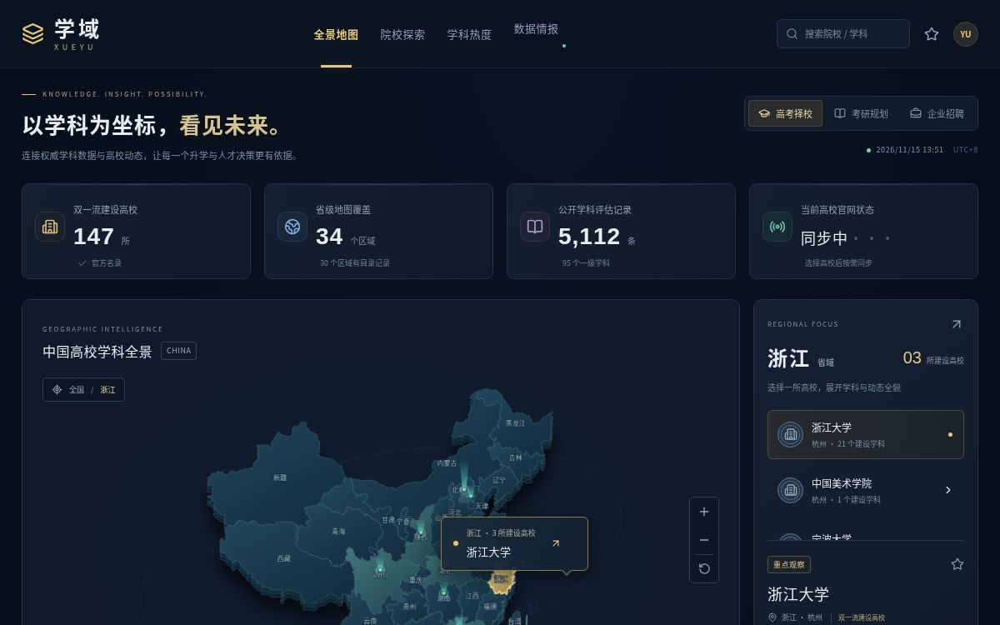
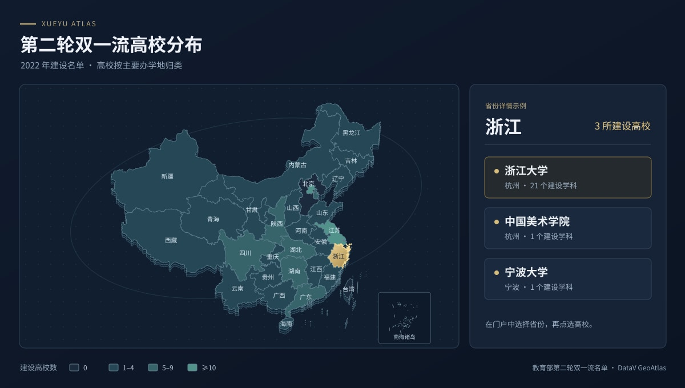
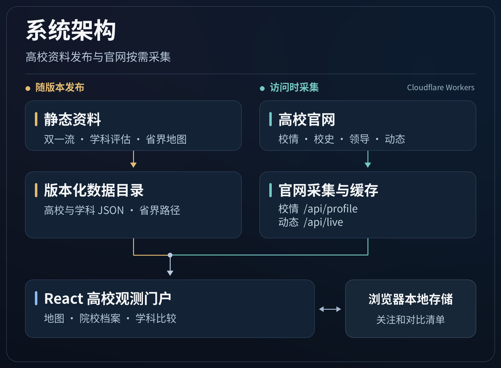

<div align="center">
  
  <h1>学域 XUEYU</h1>
  <p><strong>中国高校与学科观测平台</strong></p>
  <p>在同一张中国地图上探索高校，核对学科实力、建设名单和官网动态。</p>
  <p>
    <a href="https://xueyu-university-observatory.d65zq.chatgpt.site"><strong>打开在线演示 ↗</strong></a>
    · <a href="#系统架构">系统架构</a>
    · <a href="#快速开始">快速开始</a>
    · <a href="#数据来源">数据来源</a>
  </p>
</div>

[](https://xueyu-university-observatory.d65zq.chatgpt.site)

| 双一流建设高校 | 省级地图区域 | 第四轮一级学科 | 第四轮评估记录 |
| :---: | :---: | :---: | :---: |
| **147 所** | **34 个** | **95 个** | **5,112 条** |

## 如何使用

| 使用场景 | 从哪里开始 |
| --- | --- |
| **高考择校** | 点选省份和高校，从「校情档案」查看官网校徽、校训、校史、校友与现任校长，再查看建设学科和评估等级。 |
| **考研规划** | 在「学科热度」选择一级学科，查看不同高校的同轮等级，把最多三所学校放在一起比较。 |
| **人才研究** | 在高校详情中查阅学科背景和就业质量报告入口。对比结果可导出 CSV。 |
| **追踪高校动态** | 在「数据情报」选择高校，按招生、学术、就业或校园动态查看官网标题及原文。 |



> 学科热度以第二轮双一流建设覆盖度衡量，计算方式为该学科的建设高校数 ÷ 覆盖最多学科的建设高校数 × 100。评估等级和就业信息各自保留轮次、年份及出处。

## 系统架构

[](docs/images/system-architecture.png)

点击架构图可查看原始尺寸。

**前端**使用 React、TypeScript 和 Vinext。立体视图由省界路径叠层绘制，地图与高校目录共享省份标识。**校情与动态接口**运行在 Cloudflare Workers，按高校 ID 查询校方公开资料，检查 `robots.txt`。校情接口定位学校简介、标识、校史、现任领导和校友栏目，动态接口提取新闻标题、链接与可识别日期。

高校动态在页面打开时每 15 分钟检查一次。校情档案在打开高校详情时核验，成功匹配的校方结果缓存 12 小时。首批 11 所高校内置逐项核验的档案与官方独立校徽，其他院校按官网公开资料提供已核验字段。

| 代码入口 | 职责 |
| --- | --- |
| [`app/page.tsx`](app/page.tsx) | 地图入口、院校搜索、学科查询、详情与对比 |
| [`components/xueyu/china-map.tsx`](components/xueyu/china-map.tsx) | 省界视图、选区和 2D／3D 切换 |
| [`app/api/profile/route.ts`](app/api/profile/route.ts) | 校情档案、校方来源识别和按需核验 |
| [`app/api/live/route.ts`](app/api/live/route.ts) | 官网动态采集、解析和缓存 |
| [`lib/catalog.ts`](lib/catalog.ts) 与 [`lib/data/`](lib/data/) | 高校目录、评估与就业证据、官网入口 |
| [`scripts/prepare-map.py`](scripts/prepare-map.py) | 将原始 GeoJSON 投影为地图路径 |

## 快速开始

需要 Git 和 **Node.js 22.13 或更新版本**。克隆项目并安装依赖。

```bash
git clone https://github.com/xqxq-2020/university-observatory.git
cd university-observatory
npm ci
npm run dev
```

打开 [http://localhost:5173](http://localhost:5173)。可用以下命令验证数据一致性、采集规则并构建项目。

```bash
node scripts/check-data.mjs
node scripts/test-crawler.mjs
node scripts/test-school-profile.mjs
npm run build
```

地图数据可通过 `python scripts/prepare-map.py data/source/china-geoatlas.json` 重新生成。

## 数据来源

| 数据 | 收录口径 | 原始来源 |
| --- | --- | --- |
| 第二轮双一流 | 2022 年 147 所高校及公开建设学科。北大、清华按自主确定建设学科标记。 | [教育部名单附件](https://www.moe.gov.cn/srcsite/a22/s7065/202202/w020220214318455516037.pdf) |
| 第四轮学科评估 | 2017 年公开等级，保留原评估单位和档次。 | [公开结果表](data/source/evaluation4.pdf) |
| 第五轮学科评估 | 截至 2026-11-15，收录 4 所高校公开披露的 6 条可核验等级。 | [逐条披露证据](lib/data/evidence5.json) |
| 就业信息 | 6 所高校的就业质量报告入口，统计年份与口径以报告为准。 | [报告与统计期](lib/data/employment.json) |
| 地图 | 34 个省级区域，按高校主要办学地计数。 | [DataV GeoAtlas](https://geo.datav.aliyun.com/areas_v3/bound/100000_full.json) |
| 高校校情 | 校徽、校训、办学源流、校史、知名校友与现任校长，逐项保留校方出处。 | [首批院校档案](lib/data/university-profiles.json) |
| 高校动态 | 按需采集已配置官网的公开标题与链接。 | 站内每条动态附官网原文 |
